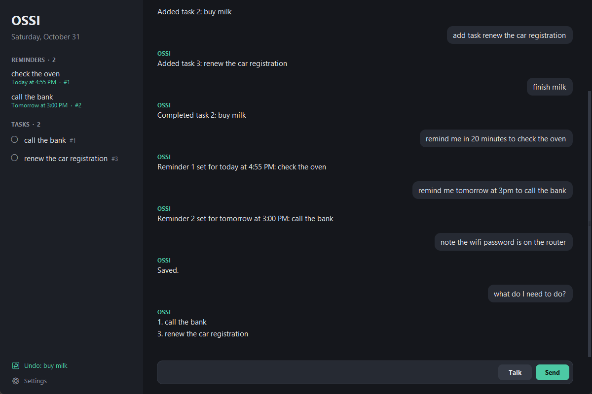
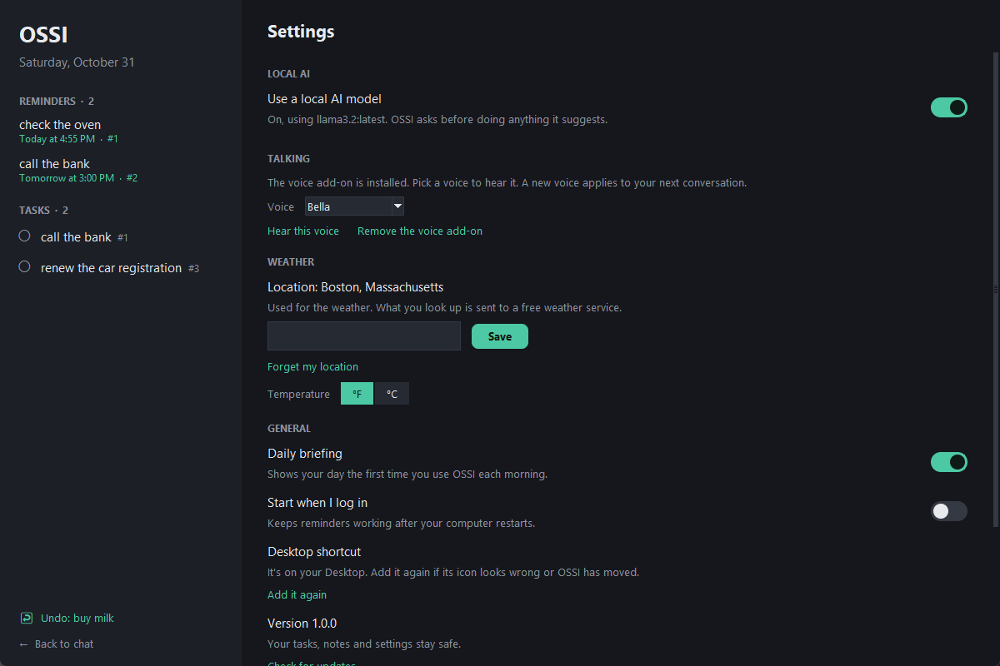

# OSSI

A personal assistant desktop app that runs on your own computer. No AI key, no account, no cloud.



## What it does

- **Daily briefing:** see today's reminders, tasks and weather when you first open the window.
- **Weather:** ask about any day in the next week, here or anywhere else.
- **Reminders:** get a Windows notification at the time you ask for.
- **Tasks and notes:** add them by typing, and search your notes later.
- **Local AI (optional):** a model on your own computer handles what the commands don't understand.
- **Talking (optional):** have a spoken conversation, entirely on your own computer.

OSSI only understands what it's been taught, but it copes with typos, polite wording and follow-ups
like `finish it`.

Your data stays in a local file, `~/.ossi/ossi.db`, outside this repo. OSSI only uses the internet
for weather, downloading the optional add-ons, and checking for updates when you ask. Your tasks,
notes and reminders are never sent.

## Get started

You need Windows and Python 3.11 or newer. There's nothing else to install, unless you want the
optional [Local AI](#local-ai-optional) or [Talking](#talking-optional).

[Download the latest release](https://github.com/BrayanVillatoro/OSSI/releases/latest), unzip it,
and double-click `OSSI.pyw` to open the app. The first time, OSSI offers to add itself to your Desktop
with its own icon.

If you delete the shortcut, or OSSI moves, you can add it again in **Settings**. A shortcut made by
hand shows Python's icon instead.

## Using the app

Type in the box at the bottom of the window and press Enter. Type `help` to see every command.

| Type | What happens |
| --- | --- |
| `briefing` | Shows your daily briefing |
| `set my location to 02108` | Sets your location, by ZIP code or city |
| `weather` or `will it rain tomorrow` | Shows the weather for your location |
| `what's the weather in Paris` | Shows the weather somewhere else |
| `remind me tomorrow at 3pm to call the bank` | Sets a reminder |
| `reminders` | Lists upcoming reminders |
| `cancel reminder 2` | Cancels a reminder |
| `add task call the bank` | Adds a task |
| `tasks` | Lists open tasks |
| `done 1` or `finish buy milk` | Completes a task, by number or name |
| `undo` | Reopens the task you completed most recently |
| `note the wifi password is on the router` | Saves a note |
| `find note wifi` | Searches your notes |
| `exit` | Quits OSSI completely |

You can also click the circle next to a task to complete it, and right-click a message to copy it.

### Settings

Click **Settings** at the bottom of the sidebar to turn on the AI, set your location, switch between
°F and °C, turn off the daily briefing, start OSSI when you log in, add it to your Desktop, report a bug, or sponsor OSSI.



### Reminders

Reminders only fire while OSSI is running, so closing the window hides it instead of quitting. To
keep them working after a restart, turn on **Start when I log in** in Settings. Anything that came
due while OSSI wasn't running appears as a missed reminder the next time it starts.

### Updating

In **Settings**, click **Check for updates**, then **Update now**. OSSI restarts on the new version
and your tasks, notes and settings stay safe. Anything typed in the box and not yet sent is lost.

OSSI only checks when you ask. If you got OSSI with git, use `git pull` instead and open it again.

## Local AI (optional)

OSSI works fully without AI. To have it handle messages like
`I need to call the bank sometime tomorrow`, run a model on your own computer with
[Ollama](https://ollama.com/). Installing Ollama doesn't download a model, so that takes a separate
command:

1. Download Ollama from [ollama.com](https://ollama.com/) and install it.
2. Open Command Prompt: open the Start menu, type `cmd` and press Enter.
3. Paste this command into Command Prompt and press Enter. It downloads the model, which is about
   2 GB, so it can take a while.

   ```
   ollama pull llama3.2
   ```

   If it says `ollama` isn't recognized, close Command Prompt, open a new one and try again.
4. When it says `success`, go to OSSI, click **Settings** and turn on **Use a local AI model**.

Good to know:

- **Privacy:** your messages stay on your computer. The model sees your message, the last few
  messages, the time, and your open tasks and upcoming reminders. It doesn't see your saved notes
  or location, unless they came up in those recent messages.
- **Control:** OSSI asks before running anything the model suggests, and the model can't change your
  settings.
- **Speed:** replies appear as the model writes them, and the first words can take a while without a
  dedicated graphics card. Say `never mind` to stop one.
- **Accuracy:** models can get things wrong, so check what it suggests.

## Talking (optional)

Talk to OSSI and it talks back, for as long as you like.

1. Set up the [Local AI](#local-ai-optional) first.
2. Click **Talk** next to the message box. The first time, OSSI offers to install its voice add-on,
   about 600 MB. After that it works offline.
3. Just start talking. Say `goodbye` or click **End** to finish.

Good to know:

- **Use a headset.** You can talk over OSSI to interrupt it, but on speakers the microphone can hear
  OSSI's own voice and cut it off.
- **Privacy:** the microphone only stays on during a conversation, and you can click **Mute** at any
  time. What you say is never saved as audio or sent anywhere, though the words appear in the chat.
- **Speed:** expect a pause of a few seconds before each reply.
- **Actions:** looking things up happens right away. For anything that changes something, like
  adding a task, OSSI asks first and you answer out loud.
- **Memory:** OSSI forgets the conversation when it closes.
- **Language:** English only for now.

To hear and choose a voice, or to remove the add-on, go to **Settings**.

## Development

See [docs/development.md](docs/development.md) for terminal commands, the project layout, adding a
skill and running the tests.

## License

See [LICENSE](LICENSE).
